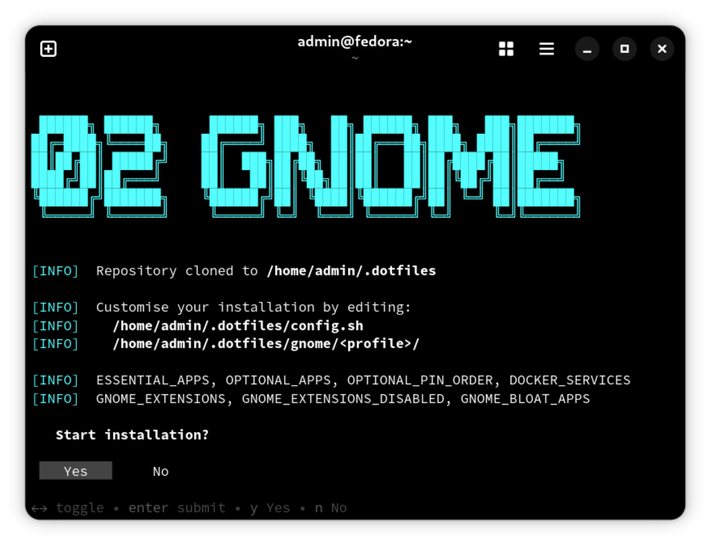
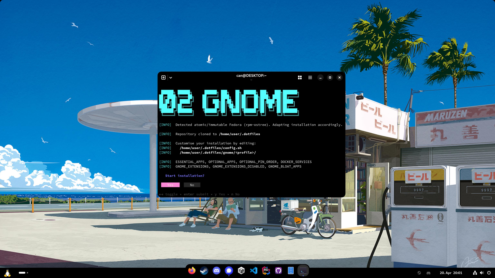
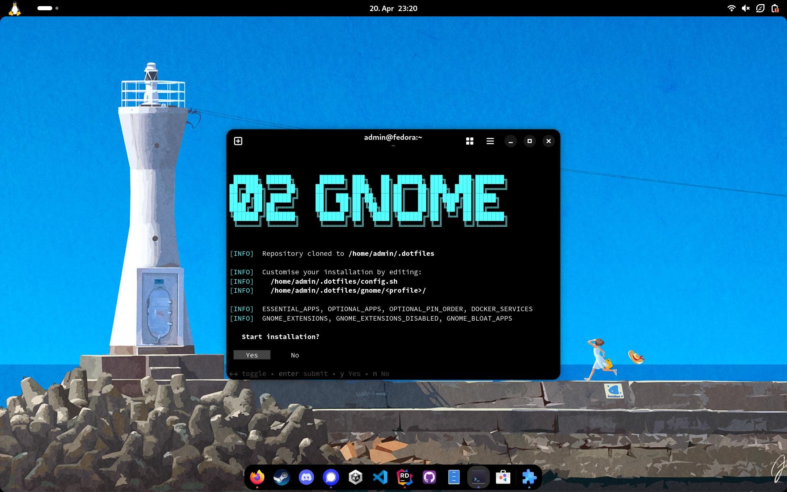

<h1 align="center" style="text-align:center">02Gnome</h1>
<h4 align="center" style="text-align:center">
Configure and customize your GNOME environment in one command.<br>Extensions, themes, apps, and settings. All set up interactively.
</h4>
<p align="center" style="text-align:center">
20 minutes is all it takes to go from zero to a custom Fedora environment using 02Gnome.
<br><em>
Works on Fedora Workstation and atomic variants (Silverblue, Bazzite), and other distros (Nobara, Ubuntu, Arch, etc.).
</em></p>

<p align="center" style="text-align:center">
  
  
  
  
  <a href="LICENSE"></a>
  <a href="https://deepwiki.com/EggyStudio/02Gnome"></a>
</p>


## Recommended Base Install

Download [**Fedora Workstation 45**](https://fedoraproject.org/workstation/download/) and write it to a USB drive with [**Fedora Media Writer**](https://github.com/FedoraQt/MediaWriter), which downloads the image and makes the drive bootable.

> For an atomic variant, take [Silverblue](https://fedoraproject.org/atomic-desktops/silverblue/download/) or [Bazzite](https://bazzite.gg/) instead.

## Quick Installation

```bash
curl -fsSL tinyurl.com/02gnome | bash
```

The same script at its full address:

```bash
curl -fsSL https://raw.githubusercontent.com/EggyStudio/02Gnome/main/install.sh | bash
```



<!-- TOC -->

- [Quick Installation](#quick-installation)
- [Desktop Profile](#desktop-profile)
- [Laptop Profile](#laptop-profile)
- [Keyboard Shortcuts](#keyboard-shortcuts)
- [Theming](#theming)
- [Removing GNOME Applications](#removing-gnome-applications)
- [What the Installer Does](#what-the-installer-does)
- [Essential Applications](#essential-applications)
- [GNOME Shell Extensions](#gnome-shell-extensions)
- [Optional Applications](#optional-applications)
- [Docker Compose Services](#docker-compose-services)
- [Atomic Fedora Support](#atomic-fedora-support)
- [Project Structure](#project-structure)
- [Customization](#customization)
- [License](#license)

## Desktop Profile

- The panel is at the **bottom**, with the clock on the **right**.
- Notification banners appear in the **bottom right** corner.
- Workspaces are dynamic.
- The screen never blanks.
- Tap to click and automatic brightness are off.
- The power button opens the shutdown dialog.



## Laptop Profile

- The panel is at the **top**, with the clock in the **center**.
- Workspaces are dynamic.
- Brightness follows the ambient light sensor.
- The screen dims, then blanks after 5 minutes idle.
- Closing the lid suspends, on battery and on AC.
- The touchpad has tap to click, natural scrolling and two-finger scrolling.



## Keyboard Shortcuts

Both profiles set these shortcuts:

- `Super+D` shows the desktop.
- `Super+E` opens Files.
- `Super+T` opens the terminal.
- `Super+Space` opens the ArcMenu runner.
- `Super+C` opens OpenCode, when OpenCode is installed.

## Theming

- **adw-gtk3** is installed through the system's package manager, so GTK 3 applications match libadwaita's Adwaita.
- Flatpak applications get read access to `gtk-3.0` and `gtk-4.0` in `~/.config`.
- The **Rewaita** themes in `assets/themes/dark` and `assets/themes/light` are copied into Rewaita's data folder, and the one for the current color scheme is applied through Rewaita's `--theme` option.
- The **Oled** question at the start chooses the pure black dark theme, which also applies to Firefox through Add Water, to Text Editor and to the terminal.
- **Add Water** themes Firefox, and `firefox/user.js` and `firefox/policies.json` set its preferences, search engine and toolbar.

## Removing GNOME Applications

When the question at the start is answered yes, the installer removes these applications, as Flatpaks and as system packages:

> Boxes · Calendar · Camera · Characters · Clocks · Connections · Contacts · Extensions · Disk Usage Analyzer · Document Scanner · Fedora Media Writer · Help · LibreOffice Calc, Impress and Writer · Maps · System Monitor · Tour · Weather

Each package's removal is run as a dry run first. When removing it would also remove `gnome-shell`, `gdm` or `mutter`, the package stays.

## What the Installer Does

The installer asks every question at its start, steps 1 to 5, and runs steps 6 to 28 without
stopping for the user. Sudo's password is asked once and kept for the whole run.

| Step | What it does |
|---|---|
| 1 | Detects an atomic Fedora, installs **git** and clones this repository to `~/.dotfiles` |
| 2 | Reads `config.sh` and the modules under `scripts/` |
| 3 | Asks for sudo's password and installs **gum** for the questions, with a plain text fallback |
| 4 | Shows where the lists live and asks whether to start |
| 5 | Asks for the profile, **Tailscale**, the **Oled** theme, the **user preferences**, the **wallpapers**, the removal of GNOME applications, the **optional applications**, the **Docker Compose services**, the **NVIDIA drivers** where a GPU has none, and the **reboot** at the end |
| 6 | Updates the system and the Flatpak applications |
| 7 | Sets up **Flatpak** and Flathub, and installs **gnome-menus**, **Docker**, **Tailscale** if chosen, and **fastfetch** |
| 8 | Imports the profile's **dconf settings** and runs its setup script |
| 9 | Installs the **essential Flatpak applications** and the **GNOME Shell extensions**, waits for GNOME Shell's settings to settle, and imports the profile's settings again, since enabling an extension rewrites the enabled list |
| 10 | Sets up the **Adwaita** themes for GTK 3 and GTK 4 |
| 11 | Installs the **Rewaita** themes and applies the one for the current color scheme |
| 12 | Applies the **Oled** choice to Add Water, Text Editor and the terminal |
| 13 | Configures **Add Water** and **Firefox**, its `user.js` and its `policies.json` |
| 14 | Applies the **user preferences** |
| 15 | Configures **Nautilus** |
| 16 | Sets up the **templates** |
| 17 | Sets the **default applications** |
| 18 | Downloads the **wallpaper collection** from [dharmx/walls](https://github.com/dharmx/walls) if chosen, with the [m-26.jp](https://github.com/dharmx/walls/tree/main/m-26.jp) folder as the slideshow |
| 19 | Removes the **GNOME applications** listed in `config.sh` if chosen |
| 20 | Installs the chosen **optional applications** |
| 21 | Sets up and starts the chosen **Docker Compose services** |
| 22 | Creates **web app shortcuts** for the services and Tailscale |
| 23 | **Pins the installed applications** to the dock, Firefox first and Files, Terminal and Software last |
| 24 | Registers the **OpenCode shortcut**, `Super+C`, if OpenCode is installed |
| 25 | **Resets the app grid** to one alphabetical view |
| 26 | Installs the **NVIDIA drivers** if chosen, `akmod-nvidia` with CUDA and VA-API |
| 27 | Updates the system again and cleans up, unused dependencies, old kernels, the journal and Flatpak |
| 28 | Reboots if chosen, and names the Tailscale sign-in if Tailscale was installed |

## Essential Applications

These are installed on every run.

| Application | Package | Description |
|---|---|---|
| Firefox | `firefox` (system package, Flatpak on atomic systems) | Web browser |
| Flatseal | `com.github.tchx84.Flatseal` | Manages Flatpak permissions |
| Extension Manager | `com.mattjakeman.ExtensionManager` | Browses and toggles GNOME extensions |
| Pins | `io.github.fabrialberio.pinapp` | Creates application shortcuts |
| Add Water | `dev.qwery.AddWater` | Applies the Adwaita theme to Firefox |
| Rewaita | `io.github.swordpuffin.rewaita` | Brings color to Adwaita |
| Mission Center | `io.missioncenter.MissionCenter` | Monitors system resources |
| Web App Hub | `org.pvermeer.WebAppHub` | Manages web applications |
| GNOME Tweaks | `gnome-tweaks` (system package) | Advanced GNOME settings |
| fastfetch | `fastfetch` (system package) | Shows system information |

## GNOME Shell Extensions

These are installed on every run.

| Extension | UUID | State |
|---|---|---|
| AppIndicator | `appindicatorsupport@rgcjonas.gmail.com` | Enabled |
| ArcMenu | `arcmenu@arcmenu.com` | Enabled |
| Clipboard History | `clipboard-history@alexsaveau.dev` | Enabled |
| Dash to Dock | `dash-to-dock@micxgx.gmail.com` | Enabled |
| Gtk4 Desktop Icons NG (DING) | `gtk4-ding@smedius.gitlab.com` | Enabled |
| Just Perfection | `just-perfection-desktop@just-perfection` | Enabled |
| Logo Menu | `logomenu@aryan_k` | Enabled |
| Panel Corners | `panel-corners@aunetx` | Enabled |
| PiP on top | `pip-on-top@rafostar.github.com` | Enabled |
| Quick Settings Audio Panel | `quick-settings-audio-panel@rayzeq.github.io` | Enabled |
| Restart To | `restartto@tiagoporsch.github.io` | Enabled |
| Rounded Window Corners Reborn | `rounded-window-corners@fxgn` | Installed, disabled |
| User Themes | `user-theme@gnome-shell-extensions.gcampax.github.com` | Enabled |
| Vitals | `Vitals@CoreCoding.com` | Installed, disabled |
| Wallpaper Slideshow | `azwallpaper@azwallpaper.gitlab.com` | Enabled |

> An installed extension whose `metadata.json` does not list the running GNOME Shell version gets that version added, so GNOME Shell loads it before its next release.

## Optional Applications

The question at the start offers any combination of these:

| Category | Application | Source |
|---|---|---|
| Entertainment | Steam | RPM, from RPM Fusion |
| Entertainment | Discord, Signal, VLC | Flatpak |
| Creative | Blender, GIMP, Unity Hub | Flatpak |
| Utilities | VS Code, JetBrains Rider, GitHub Desktop, Trayscale | Flatpak |
| Developer | Claude (AI assistant) | Script |
| Developer | OpenCode (AI coding agent) | Script |
| Runtimes | .NET SDK and runtimes, LTS and STS | Script |

The installed optional applications are **pinned to the dock**.

## Docker Compose Services

The question at the start offers any combination of these. Each chosen service is copied to a folder in the home folder and started.

| Service | Folder | Address | Description |
|---|---|---|---|
| Immich | `~/immich` | http://localhost:2283 | Self-hosted photo and video management |
| Nextcloud | `~/nextcloud` | http://localhost:8080 | Self-hosted file sync and collaboration |
| Ollama + Open WebUI | `~/ollama` | http://localhost:3000 | Local LLM inference with a web chat interface |
| ZeroTier One | `~/zerotierone` | [central.zerotier.com](https://central.zerotier.com) | Peer-to-peer virtual network |

Each folder holds the service's `docker-compose.yml` and a `README.md`, which names the versions the images are pinned to and what an earlier install does to upgrade. The database passwords in `.env` are generated at the install, and an existing `.env` is kept.

These commands run in a service's folder:

```bash
docker compose up -d      # Start in the background
docker compose down       # Stop
docker compose pull       # Pull the updates within the pinned versions
docker compose up -d      # Restart with the pulled images
```

## Atomic Fedora Support

The installer detects an atomic Fedora variant, such as Silverblue or Bazzite, by `/run/ostree-booted` and adapts these steps:

| Area | Fedora Workstation | Atomic Fedora |
|---|---|---|
| System packages | `dnf install` | `rpm-ostree install --idempotent` |
| System updates | `dnf update` | `rpm-ostree upgrade` |
| Package removal | `dnf remove`, with a dry run first | `rpm-ostree uninstall` or `override remove` |
| Firefox | RPM package | Flatpak (`org.mozilla.firefox`) |
| Docker | DNF and the Docker CE repository | rpm-ostree layering and the Docker CE repository |
| NVIDIA drivers | `akmod-nvidia` through DNF | `akmod-nvidia` through rpm-ostree |
| RPM Fusion | `dnf install` of its RPM | `rpm-ostree install` of its RPM |
| gum | DNF and the Charm repository | The release binary in `~/.local/bin` |
| Flatpak applications | Same | Same |
| GNOME extensions | Same | Same |
| dconf and gsettings | Same | Same |

> On an atomic system, an rpm-ostree change takes effect at the next boot, so Docker and the Compose services start after the reboot, which the question at the start can schedule for the end of the run.

## Project Structure

```
02Gnome/
├── install.sh                  # The installer, run through curl | bash
├── config.sh                   # The lists of applications, extensions, removals and services
├── AGENTS.md                   # The repository's layout and conventions
├── .github/
│   ├── assets/                 # The README's pictures
│   ├── COMMITS.md              # How work reaches the history
│   ├── REVIEW.md               # The review and its items
│   └── STYLE.md                # The rules for comments, messages and Markdown
├── assets/
│   ├── icons/
│   │   ├── immich.png              # Immich web app icon
│   │   ├── nextcloud.png           # Nextcloud web app icon
│   │   ├── open-webui-light.png    # Open WebUI web app icon
│   │   ├── tailscale-light.png     # Tailscale web app icon
│   │   ├── tux-logo.svg            # Tux logo
│   │   └── zerotier.png            # ZeroTier web app icon
│   └── themes/
│       ├── dark/                   # The default and the pure black Rewaita themes
│       └── light/                  # The default light Rewaita theme
├── docker/
│   ├── immich/
│   │   ├── docker-compose.yml  # Immich's release file
│   │   ├── env                 # Immich's settings, copied as .env
│   │   └── README.md
│   ├── nextcloud/
│   │   ├── docker-compose.yml  # Nextcloud, PostgreSQL and Redis
│   │   ├── env                 # Nextcloud's settings, copied as .env
│   │   └── README.md
│   ├── ollama/
│   │   ├── docker-compose.yml  # Ollama and Open WebUI
│   │   └── README.md
│   └── zerotierone/
│       ├── docker-compose.yml  # ZeroTier One
│       └── README.md
├── firefox/
│   ├── policies.json           # Enterprise policies, the search engine and the toolbar
│   └── user.js                 # Privacy, theme and interface preferences
├── gnome/
│   ├── desktop/
│   │   ├── 01-interface.dconf  # Interface and appearance
│   │   ├── 02-shortcuts.dconf  # Keyboard shortcuts
│   │   ├── 03-dock.dconf       # Dash to Dock
│   │   ├── 04-extensions.dconf # The extensions' settings
│   │   ├── 05-apps.dconf       # Application defaults, the terminal and Text Editor among them
│   │   └── setup.sh            # The desktop profile's setup
│   └── laptop/
│       ├── 01-interface.dconf  # Interface and appearance
│       ├── 02-shortcuts.dconf  # Keyboard shortcuts
│       ├── 03-dock.dconf       # Dash to Dock
│       ├── 04-extensions.dconf # The extensions' settings
│       ├── 05-apps.dconf       # Application defaults, the terminal and Text Editor among them
│       └── setup.sh            # The laptop profile's setup
├── scripts/
│   ├── 01-common.sh            # Colors, the questions, sudo, package helpers
│   ├── 02-bootstrap.sh         # git, gum, Flatpak, the system update
│   ├── 03-docker.sh            # Docker, Tailscale, the Compose services, web app shortcuts
│   ├── 04-extensions.sh        # GNOME Shell extensions
│   ├── 05-apps.sh              # Essential and optional applications
│   ├── 06-gnome.sh             # dconf, the profile, preferences, Nautilus, templates, the dock
│   ├── 07-themes.sh            # Adwaita, Rewaita, Oled, Add Water, Firefox
│   └── 08-cleanup.sh           # Wallpapers, removals, NVIDIA drivers, cleanup, reboot
├── LICENSE                     # GNU GPL v3.0
└── README.md
```

## Customization

The lists live in `config.sh`, which the installer reads before its modules:

| Array | Holds | Form of an entry |
|---|---|---|
| `ESSENTIAL_APPS` | Flatpaks installed on every run | `"flatpak-id"` |
| `OPTIONAL_APPS` | The optional applications offered at the start | `"Label\|type:id"`, with `flatpak`, `rpm` or `script` as the type |
| `GNOME_EXTENSIONS` | Extensions installed and enabled | `"uuid\|Name"` |
| `GNOME_EXTENSIONS_DISABLED` | Extensions installed and left disabled | `"uuid\|Name"` |
| `GNOME_BLOAT_APPS` | GNOME applications offered for removal | `"flatpak-id\|dnf-package\|pacman-package\|Name"`, with `-` where there is none |
| `OPTIONAL_PIN_ORDER` | The order of optional applications in the dock | `"flatpak-id\|desktop-file-name"` |
| `DOCKER_SERVICES` | The Compose services offered at the start | `"Label\|folder"`, a folder under `docker/` |

A profile's GNOME settings are the `.dconf` files in `gnome/desktop/` or `gnome/laptop/`, loaded in number order with `dconf load /`, so each section names a full path such as `[org/gnome/desktop/interface]`. The current value of a key is read with `dconf read`, as in:

```bash
dconf read /org/gnome/desktop/interface/clock-format
```

and written into the section of the matching file. The profile's `setup.sh` runs after its files load.

The installer clones the address in `REPO_URL` at the head of `install.sh`, so a fork sets it to its own address, and its later installs take what it has pushed.

## License

This project is licensed under the **GNU General Public License v3.0 or later**, as the [LICENSE](LICENSE) file sets out.
